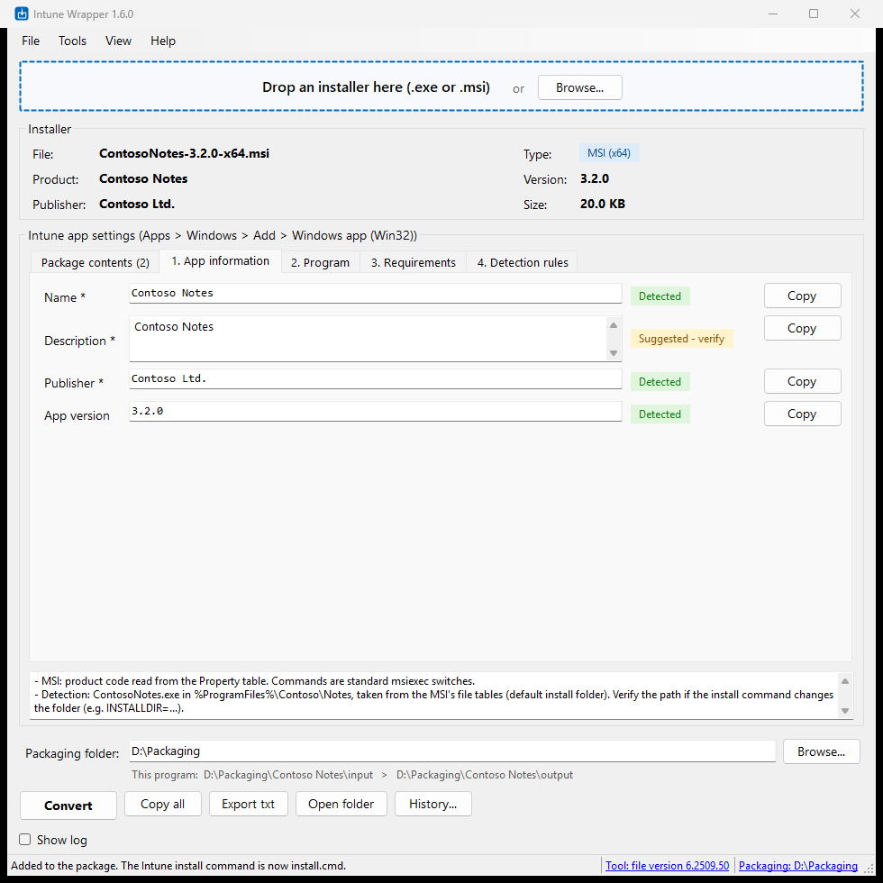

# Intune Wrapper

**Turn an `.exe` or `.msi` installer into a ready-to-upload Microsoft Intune Win32 app**: the `.intunewin` package, plus every value the Intune admin center asks for (install and uninstall command, requirements and a File detection rule), checked so the portal accepts them.

Intune Wrapper is a free, open-source Windows desktop tool for IT administrators and application packagers. It wraps Microsoft's [Win32 Content Prep Tool](https://github.com/microsoft/Microsoft-Win32-Content-Prep-Tool) (`IntuneWinAppUtil.exe`) in a guided window. No PowerShell knowledge is needed.

## Features

- **Drag and drop** an `.exe` or `.msi`. Name, version, publisher and installer type are read from the file.
- **Silent install and uninstall commands**: exact for MSI (product code), and suggested for EXE installers built with Inno Setup, NSIS, InstallShield, WiX Burn, Squirrel and install4j.
- **All Intune wizard fields**, laid out like the portal's *Add Win32 app* steps: App information, Program, Requirements and Detection rules.
- **File detection rules** with Intune's own validation, so values like `<PATH: ...>` can never be pasted into the portal.
- **Auto-detect in Windows Sandbox**: installs the app silently in a disposable Sandbox, finds the uninstall command and main program file, checks the detection rule, then uninstalls and checks that the app is gone. Your PC is not changed.
- **Capture on this PC** as a fallback: you install and uninstall by hand while the tool records what changed, and checks the results.
- **Drivers and extra installers**: add INF driver folders, a second `.exe`/`.msi`, or other files. A generated `install.cmd` installs everything in order with proper exit codes.
- **Tidy packaging folders**: `D:\Packaging\<App>\input` and `\output` per app, with the packaging tool kept in one place.
- **Confidence badges** on every value: *Detected*, *Suggested*, *Unknown* or *Edited*. You always know what to double-check.
- **Copy, Copy all, text export and history** of the last 50 conversions.
- A single portable `IntuneWrapper.exe`: no installation, no admin rights, no PowerShell modules.

## Quick start

1. Download the latest release zip from **[Releases](https://github.com/W1zz4rdXB/IntuneWrapper/releases/latest)** and extract it. See the **[Installation guide](docs/INSTALLATION.md)**.
2. Start `IntuneWrapper.exe`. On first start it offers to download `IntuneWinAppUtil.exe` from Microsoft's GitHub.
3. Drop an installer on the window, check the four tabs, and click **Convert**.
4. In the Intune admin center, go to **Apps > Windows > Add > Windows app (Win32)**, upload the `.intunewin` and copy the values over tab by tab.

The **[User manual](docs/USER_MANUAL.md)** explains every screen and option.

## Requirements

- Windows 10 1809 or later, or Windows 11, with .NET Framework 4.8 (included in current Windows).
- Optional, for Auto-detect: Windows Sandbox (Windows 10/11 Pro, Enterprise or Education, with virtualization enabled).
- Internet access only to download `IntuneWinAppUtil.exe` from GitHub once. Intune Wrapper sends no telemetry.

## Documentation

| Document | For |
|---|---|
| [Installation guide](docs/INSTALLATION.md) | Download, verify, first start, Windows Sandbox, updating and removing |
| [User manual](docs/USER_MANUAL.md) | Using every feature, and uploading the result to Intune |
| [Changelog](CHANGELOG.md) | What changed in each version |
| [Contributing](CONTRIBUTING.md) | Building from source, tests, pull requests |
| [Security policy](SECURITY.md) | Reporting vulnerabilities privately |
| [Design specification](SPEC.md) | Original requirements and design decisions |

## License

Intune Wrapper is released under the [MIT License](LICENSE). Copyright (c) 2026 Intune Wrapper contributors.

`IntuneWinAppUtil.exe` is Microsoft software under its own license terms. It is **not** included: Intune Wrapper downloads it from Microsoft's GitHub repository when you ask it to. See [Third-party notices](THIRD-PARTY-NOTICES.md).

Intune Wrapper is not affiliated with or endorsed by Microsoft. Microsoft, Intune and Windows are trademarks of the Microsoft group of companies.

## Disclaimer

The software is provided "as is", without warranty of any kind. Generated commands and detection rules are suggestions: **always test a package on a test device before you deploy it.**
