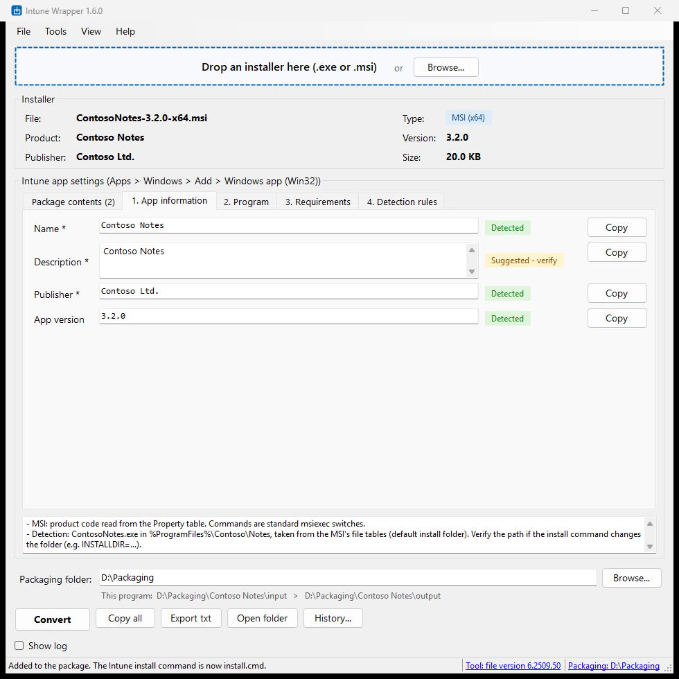
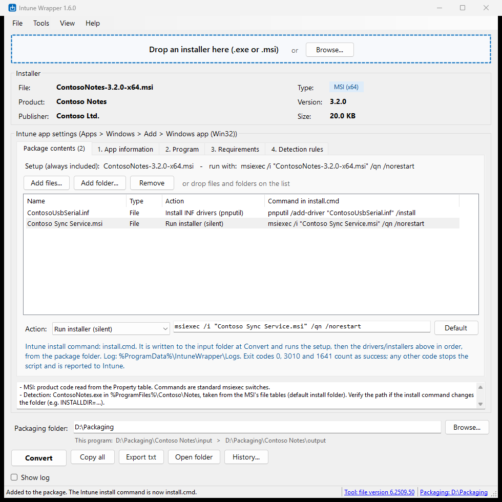
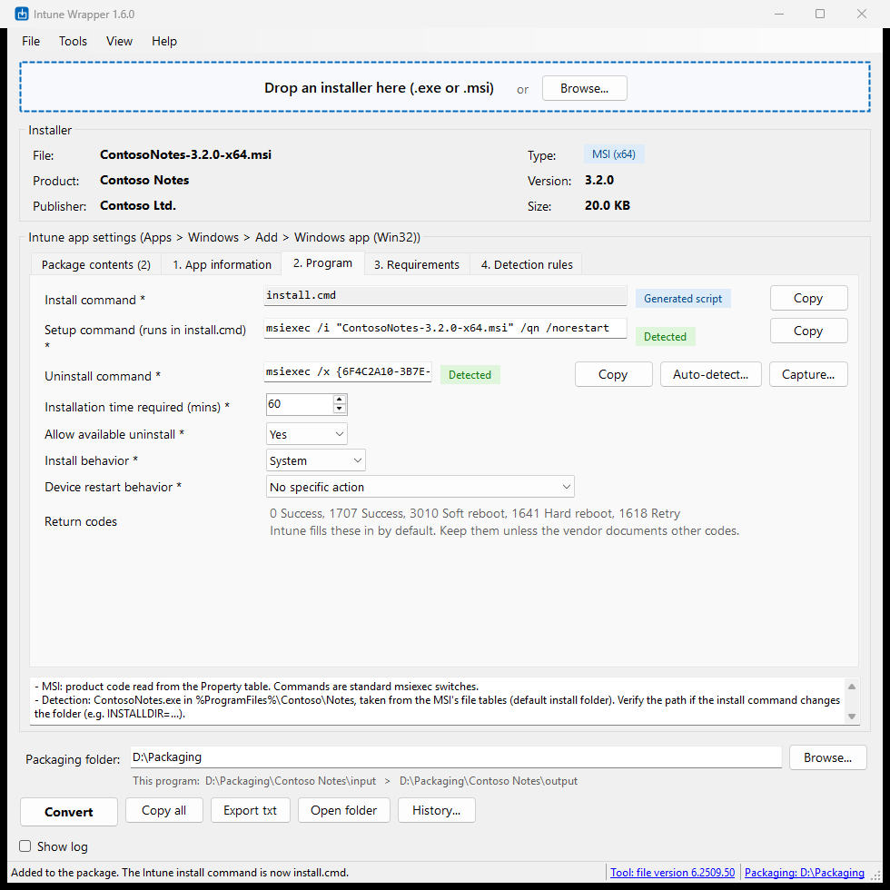
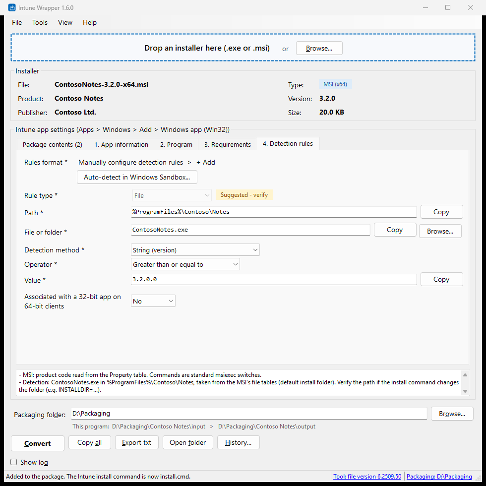

# Intune Wrapper: User manual

Version 1.6. This manual explains every screen of Intune Wrapper, and how to bring the result into Microsoft Intune. To install the tool, see the [Installation guide](INSTALLATION.md).

## Contents

1. [Overview](#1-overview)
2. [The main window](#2-the-main-window)
3. [Loading an installer](#3-loading-an-installer)
4. [Confidence badges and warnings](#4-confidence-badges-and-warnings)
5. [Package contents: drivers and extra files](#5-package-contents-drivers-and-extra-files)
6. [1. App information](#6-tab-1-app-information)
7. [2. Program](#7-tab-2-program)
8. [3. Requirements](#8-tab-3-requirements)
9. [4. Detection rules](#9-tab-4-detection-rules)
10. [Auto-detect in Windows Sandbox](#10-auto-detect-in-windows-sandbox)
11. [Capture on this PC](#11-capture-on-this-pc)
12. [Convert: creating the .intunewin package](#12-convert-creating-the-intunewin-package)
13. [Copy, Copy all and Export](#13-copy-copy-all-and-export)
14. [Uploading to Intune, step by step](#14-uploading-to-intune-step-by-step)
15. [History](#15-history)
16. [Settings and the packaging tool](#16-settings-and-the-packaging-tool)
17. [Supported installer types](#17-supported-installer-types)
18. [Keyboard shortcuts and command line](#18-keyboard-shortcuts-and-command-line)
19. [Troubleshooting and FAQ](#19-troubleshooting-and-faq)

---

## 1. Overview

A Win32 app in Intune needs two things:

1. a **`.intunewin` package**: the installer, compressed and encrypted by Microsoft's `IntuneWinAppUtil.exe`;
2. the **settings** you type into the *Add Win32 app* wizard: install and uninstall commands, requirements and a detection rule that tells Intune whether the app is installed.

Intune Wrapper produces both. The typical workflow is:

1. **Drop** the installer on the window.
2. **Check** the four tabs, which mirror the Intune wizard, and fix anything marked *Unknown* or *(!)*.
3. For EXE installers: use **Auto-detect** (Windows Sandbox) or **Capture** to find the uninstall command and detection rule.
4. **Convert** to create the `.intunewin`.
5. **Copy** the values into the Intune admin center.

---

## 2. The main window



From top to bottom:

| Area | Purpose |
|---|---|
| **Drop zone** | Drop an `.exe` or `.msi` here (or anywhere on the window), or click **Browse...** |
| **Installer** | What was read from the file: name, product, version, publisher, size and the detected **type** (for example *MSI (x64)* or *EXE: Inno Setup*) |
| **Intune app settings** | The yellow warning banner, the tabs (Package contents, then the four Intune wizard steps) and the **Notes** box below them, which explains where each value came from |
| **Packaging folder** | Root folder for all packages. The line below it shows the input and output folders of the current app. |
| **Buttons** | **Convert**, **Copy all**, **Export txt**, **Open folder**, **History...** |
| **Show log** | Shows the packaging tool's output and the application log |
| **Status bar** | Current status, the packaging tool's version (click to set it up) and the packaging folder (click to open it) |

---

## 3. Loading an installer

You can load an installer in any of these ways:

- Drag an `.exe` or `.msi` onto the window.
- Click **Browse...** or press **Ctrl+O**.
- Drag it onto `IntuneWrapper.exe` itself, or start `IntuneWrapper.exe <installer>`.

Intune Wrapper then reads the file:

- **MSI:** product code, name, version and manufacturer from the MSI database. It also reads the architecture (x64/x86/ARM64) and the main program file with its install folder, which is used for the detection rule.
- **EXE:** name, version and publisher from the file's version information. It scans the file for known installer frameworks (Inno Setup, NSIS, InstallShield, WiX Burn, Squirrel, install4j) to suggest silent switches.

Folders and other file types are refused with an explanation. If you drop several files at once, the first one is loaded as the installer, and you're asked whether to add the others to the package contents.

> **Tip:** the program name (*Name* on the App information tab) is also the name of the app's folder in the packaging folder.

---

## 4. Confidence badges and warnings

Every generated value carries a badge, so you know how much to trust it:

| Badge | Meaning | What to do |
|---|---|---|
| **Detected** (green) | Read from the installer, the registry or a verified test install | Nothing |
| **Suggested - verify** (amber) | Inferred, for example the standard switches of a framework | Test it once |
| **Unknown - fill in** (red) | A placeholder or a guess | Fill it in, or use Auto-detect / Capture |
| **Edited** (blue) | You changed it; your value is used everywhere | Nothing |
| **Optional** (grey) | Intune doesn't require it | Optional |

Two more signals:

- **(!) on a tab:** a required Intune field on that tab is missing or invalid.
- **Yellow banner:** lists exactly which fields are still required, and what to do next.

Placeholders look like `<UNINSTALL COMMAND: use Capture mode>`. They can't be copied (see [Copy](#13-copy-copy-all-and-export)), so they never end up in Intune by accident.

---

## 5. Package contents: drivers and extra files



Some apps need more than the installer: a driver, a second installer, or a configuration file. Add them on the **Package contents** tab:

- **Add files...** or **Add folder...**, or drop files and folders on the list.
- Select an item to change its **Action** and command:

| Action | What happens on the device | Default command |
|---|---|---|
| **Include only** | The file or folder is copied into the package; the setup uses it itself | none |
| **Install INF drivers (pnputil)** | Installs `.inf` driver packages | `pnputil /add-driver "Drivers\*.inf" /subdirs /install` |
| **Run installer (silent)** | Runs a second `.exe`/`.msi` after the setup | MSI: `msiexec /i "x.msi" /qn /norestart`; EXE: the framework's silent switches |

Folders that contain `.inf` files get *Install INF drivers* automatically. `.exe` and `.msi` files get *Run installer*. You can edit each command, and **Default** restores the suggested one.

### install.cmd

As soon as one item has to *run*, Intune Wrapper writes an **`install.cmd`** script into the app's input folder at Convert. The Intune install command then becomes **`install.cmd`**, and the Program tab shows this with a *Generated script* badge. The script:

1. runs the **setup command** first, then each driver/installer step in list order, from the package folder;
2. uses the 64-bit `pnputil`, even when the Intune agent runs as a 32-bit process;
3. treats exit codes **0, 3010 and 1641** as success (3010/1641 = restart needed; the script then returns 3010), and for pnputil also **259** ("no matching device present", which is normal when the hardware isn't connected);
4. stops at the first other exit code and returns it to Intune, so a failed driver install is reported as a failed install;
5. logs every step to `%ProgramData%\IntuneWrapper\Logs\<App>-install.log` on the device.

Items marked *Include only* don't need a script: the install command stays the setup command.

> The uninstall command stays the app's own uninstall command. Drivers added with pnputil remain in the Windows driver store after uninstall.

---

## 6. Tab 1: App information

The fields of the Intune wizard's *App information* step:

| Field | Source | Required |
|---|---|---|
| **Name** | Product name from the installer, or the file name | Yes |
| **Description** | File description, or the name (*Suggested*: write a description for Company Portal users) | Yes |
| **Publisher** | Manufacturer or company name; filled in by Capture/Auto-detect when the file has none | Yes |
| **App version** | Product version | No |

---

## 7. Tab 2: Program



| Field | Explanation |
|---|---|
| **Install command** | The command Intune runs. It runs from the package root, so use the file name only, e.g. `"setup.exe" /S`. With a generated script this is `install.cmd`, and the **Setup command** row below holds the setup's own command. |
| **Uninstall command** | Must be silent. For MSI it is `msiexec /x {product code} /qn /norestart`. For EXE it comes from **Auto-detect...** or **Capture...**. |
| **Installation time required (mins)** | How long Intune waits; the default is 60 |
| **Allow available uninstall** | Lets users uninstall from Company Portal when the app is assigned as *Available* |
| **Install behavior** | **System** (all users, runs as SYSTEM) or **User** (signed-in user, e.g. Squirrel apps). Set the default in Settings. |
| **Device restart behavior** | Same options as in Intune. Commands already include `/norestart` where the framework supports it. |
| **Return codes** | Intune's defaults (0, 1707, 3010, 1641, 1618). Keep them unless the vendor documents others. |

The **Auto-detect...** and **Capture...** buttons next to the uninstall command are explained in sections [10](#10-auto-detect-in-windows-sandbox) and [11](#11-capture-on-this-pc).

> **Unknown install switches:** an EXE that matches no known framework gets `/S` as a guess, marked *Unknown*. Check the vendor's documentation, or run the installer with `/?` on a test machine. Auto-detect then shows whether the command really installs silently.

---

## 8. Tab 3: Requirements

| Field | Explanation |
|---|---|
| **Operating system architecture** | Tick the same architectures in Intune (*Check operating system architecture: Yes*). Read from the MSI when available; otherwise **x64** is suggested. |
| **Minimum operating system** | Same list as Intune. The default can be set in Settings. |

Disk space, memory and additional requirement rules are optional in Intune and aren't generated.

---

## 9. Tab 4: Detection rules



Intune uses the detection rule to decide whether the app is installed. Intune Wrapper **always creates a File rule**. It points at the app's main program file, and when the file version is known it uses *String (version) Greater than or equal to* that version, so newer versions also count as installed.

| Field | Explanation |
|---|---|
| **Path** | The folder of the file, using Intune environment variables, e.g. `%ProgramFiles%\Contoso\Notes` |
| **File or folder** | The file name only, e.g. `ContosoNotes.exe` |
| **Detection method** | *File or folder exists*, *String (version)*, *Size in MB*, dates... |
| **Operator / Value** | Shown only for methods that need them, just like in Intune |
| **Associated with a 32-bit app on 64-bit clients** | *Yes* makes `%ProgramFiles%` point to `Program Files (x86)` on 64-bit devices |

Where the values come from:

- **MSI:** the main `.exe` from the MSI's file tables, in its default install folder (*Suggested*). If your install command changes the folder (e.g. `INSTALLDIR=...`), adjust Path.
- **Auto-detect / Capture:** the installed app's main program file and its real file version (*Detected* when verified).
- **Browse...:** pick the installed exe yourself, e.g. on a test machine. Path, file and version are filled in.

**Validation.** Every field is checked with the same rules as the Intune portal. The reason appears in red under the field. Typical messages:

- *Path must start with a drive (C:\...) or an environment variable (%ProgramFiles%\...)*
- *Path cannot contain / * ? " < > |*
- *File or folder must be a name only (no folder)...*
- *Value must be a version like 1.2.3.4.*

Pasting a full path such as `C:\Program Files\App\app.exe` into either field splits it into Path and File or folder automatically. Surrounding quotes are removed.

---

## 10. Auto-detect in Windows Sandbox

**Auto-detect...** (Program tab, Detection rules tab, **Tools** menu or **Ctrl+D**) finds the uninstall command and detection rule automatically, and proves they work. It needs Windows Sandbox (see the [Installation guide](INSTALLATION.md#6-optional-turn-on-windows-sandbox-for-auto-detect)).

What happens:

1. Intune Wrapper prepares the app's **input folder**: setup, extra items and `install.cmd`, exactly what will be packaged.
2. A **Windows Sandbox** window opens. Leave it alone; it takes about a minute to start.
3. Inside the Sandbox, the app is **installed silently** with the Intune install command.
4. The new uninstall entry and the main program file are found, and the **File detection rule** is built and checked.
5. The **uninstall command** runs, and the tool checks that the entry and the file are gone.
6. The Sandbox closes by itself and is discarded. Your PC is not changed.

The dialog shows each step and a result per check:

```
OK    Silent install: exit code 0 after 42 s
OK    Uninstall entry: Contoso Notes 3.2.0  (HKLM\SOFTWARE\Microsoft\Windows\CurrentVersion\Uninstall\{6F4C...})
OK    Detection rule finds the app: Rule type: File | Path: %ProgramFiles%\Contoso\Notes | File or folder: ContosoNotes.exe | ...
OK    Silent uninstall: msiexec /x {6F4C2A10-3B7E-4D2B-9C1A-5E8F0D7B2C34} /qn /norestart  (exit code 0)
OK    App removed after uninstall: entry removed, detection file gone
```

Click **Use these values** to fill in the uninstall command and detection rule. Verified values are marked *Detected*.

**If a check fails**, the log shows why. The most common cause is an install command that isn't silent: it "did not finish" within the installation time, because the installer is waiting for clicks in the Sandbox. Then:

- fix the install command (vendor documentation, `/?`) and run Auto-detect again, or
- click **Capture on this PC instead...** (next section).

---

## 11. Capture on this PC

When the silent install doesn't work, or Windows Sandbox isn't available, **Capture...** lets *you* install and uninstall the app normally while Intune Wrapper records what changes. This installs the app on your own PC for a moment, so prefer a test machine.

1. **Take snapshot.** The uninstall registry is recorded. If the app already seems to be installed, you're warned: uninstall it first, otherwise nothing new can be found.
2. **Install the app** the normal way, for example with **Start installer**, and wait until it has finished. Then click **Finish install capture**.
3. **Choose the app's entry** from the new entries. The preview shows the uninstall command and the File detection rule, and whether the rule finds the installed app.
4. **Uninstall and verify:**
   - **Run uninstall command** runs the command that will go to Intune, so it is tested too. Machine-wide apps ask for administrator approval.
   - Or uninstall it yourself (**Open Installed apps**).
   - Then click **Verify removal**. The tool checks that the uninstall entry and the program file are gone.
5. **Use these values.**

The Notes box records what was verified. Because you installed by hand, the *silent install command* itself remains unverified: check the vendor's silent switches.

---

## 12. Convert: creating the .intunewin package

Click **Convert**. Intune Wrapper then:

1. creates `<packaging folder>\<Name>\input` and `\output`;
2. copies the installer into `input` (asking first if a *different* file with the same name is already there), copies the package items, and writes `install.cmd` when needed;
3. warns if `input` contains files that aren't on the Package contents tab, for example an older installer, because **everything in `input` is packaged**;
4. asks before overwriting an existing `.intunewin` (**No** keeps the old one);
5. runs `IntuneWinAppUtil.exe` in the background (**Cancel** stops it);
6. checks that the `.intunewin` really exists, and shows its path and size with **Open folder** and **Copy path**.

If it fails, you get the exit code, a plain explanation and the last lines of the tool's output. **Show log** shows everything.

---

## 13. Copy, Copy all and Export

- **Copy** next to a field copies that value. Empty fields, placeholders and invalid detection values are **not** copied: you get the reason instead.
- **Copy all** copies every field, grouped like the Intune wizard (Package contents, App information, Program, Requirements, Detection rules). If required fields are missing, you're asked first, and the text starts with *NOT READY FOR INTUNE*.
- **Export txt** (**Ctrl+E**) saves the same overview, plus confidence and notes, as `<Name>-commands.txt` in the app's output folder. Useful for documentation or a change ticket.

---

## 14. Uploading to Intune, step by step

In the [Intune admin center](https://intune.microsoft.com): **Apps > Windows > + Add > App type: Windows app (Win32) > Select**.

| Intune wizard step | Take from Intune Wrapper |
|---|---|
| **App information**: *Select app package file* | The `.intunewin` from `<packaging folder>\<Name>\output` (**Open folder**) |
| App information fields | Tab **1. App information**: Name, Description, Publisher, App version |
| **Program** | Tab **2. Program**: Install command, Uninstall command, installation time, allow available uninstall, install behavior, device restart behavior; keep the return codes |
| **Requirements** | Tab **3. Requirements**: *Check operating system architecture: Yes* with the same architectures, and the Minimum operating system |
| **Detection rules** | *Rules format: Manually configure detection rules* > **+ Add** > Rule type **File**, then copy Path, File or folder, Detection method, Operator, Value and the 32-bit option from tab **4. Detection rules** |
| Dependencies, Supersedence, Assignments | Not generated: set these in Intune as usual |

Assign the app to a **test group first** and check one device before you roll it out.

---

## 15. History

Each conversion, successful or not, is saved in the **History** (**Ctrl+H**, last 50). Select an entry to see its details:

- **Restore** loads all its settings back, including the package contents. If the installer file still exists, it is analyzed again. If it has changed since (different SHA-256), you're warned.
- **Delete** removes the entry.

The history is stored in `%APPDATA%\IntuneWrapper\history.json`. A damaged file is backed up and reset automatically.

---

## 16. Settings and the packaging tool

**File > Settings**:

| Setting | Meaning |
|---|---|
| **Tool path** | `IntuneWinAppUtil.exe`. A copy chosen here is copied into the packaging folder. |
| **Packaging folder** | Root of all app folders and the tool |
| **Default install context** | System or User for newly loaded installers |
| **Default minimum OS** | Minimum operating system for newly loaded installers |
| **Show the log pane when the app starts** | Opens the log pane at startup |

**Tools** menu:

- **Locate IntuneWinAppUtil.exe...**: use a copy you already have.
- **Download IntuneWinAppUtil.exe...**: get the latest release from Microsoft's GitHub.
- **Check for tool update**: downloads the latest release (about 60 KB) and compares it with your copy. The tool's file version (e.g. *6.2509.50*) differs from its GitHub release number (e.g. *v1.8.7*), so the files themselves are compared.

**Help > About** (**F1**) shows the version, license and tool path. **View > Open log folder** opens the daily logs.

---

## 17. Supported installer types

| Installer | Recognised by | Install command | Uninstall command |
|---|---|---|---|
| MSI | `.msi` extension | `msiexec /i "x.msi" /qn /norestart` (Detected) | `msiexec /x {ProductCode} /qn /norestart` (Detected) |
| Inno Setup | "Inno Setup" marker | `/VERYSILENT /SUPPRESSMSGBOXES /NORESTART` | UninstallString + `/VERYSILENT /NORESTART` |
| NSIS | "Nullsoft Install System" | `/S` | UninstallString + `/S` |
| InstallShield | "InstallShield" | `/s /v"/qn /norestart"` | UninstallString + `/s /v"/qn"` |
| WiX Burn | `.wixburn` PE section | `/quiet /norestart` | QuietUninstallString |
| Squirrel | "Squirrel" + "Update.exe" | `--silent` (use the User context) | QuietUninstallString |
| install4j | "install4j" | `-q` | UninstallString + `-q` |
| Unknown | none of the above | `/S` (guess, Unknown) | Auto-detect or Capture |

The uninstall command of EXE installers comes from the registry entry they create, so use Auto-detect or Capture for EXEs.

---

## 18. Keyboard shortcuts and command line

| Keys | Action |
|---|---|
| Ctrl+O | Open installer |
| Ctrl+D | Auto-detect in Windows Sandbox |
| Ctrl+E | Export commands to a text file |
| Ctrl+H | History |
| Ctrl+L | Show or hide the log pane |
| F1 | About |
| Alt + underlined letter | Any button or field label (e.g. Alt+C = Convert) |

Enter never starts a conversion: Convert is always a deliberate click or Alt+C.

**Command line:**

```
IntuneWrapper.exe <installer> [additional files or folders...]
```

The first file is loaded as the installer. Any further files and folders are added to the package contents.

---

## 19. Troubleshooting and FAQ

**The uninstall command shows `<UNINSTALL COMMAND: use Capture mode>`.**
EXE installers don't contain their uninstall command; it's created when they install. Use **Auto-detect** or **Capture**.

**Auto-detect says the install "did not finish".**
The install command isn't silent: the installer is waiting for input in the Sandbox. Check the vendor's silent switches, fix the command and retry, or use **Capture on this PC instead...**.

**Auto-detect: "Windows Sandbox is already running".**
Only one Sandbox can run at a time. Close the open Sandbox window.

**Capture finds no new entry.**
The app was probably already installed before step 1 (uninstall it first), or the installation hadn't finished. Some apps (portable apps, MSIX/Store apps) don't register an uninstall entry at all. Use **Back** to take the second snapshot again.

**Intune reports the app as "not detected" after installation.**
Check the File rule on a device where the app is installed: does the file exist at the Path? Is the 32-bit option right? Is the installed file version at least the Value? An MSI installed with a custom `INSTALLDIR` needs that Path.

**The package contains files I didn't expect.**
Everything in `<packaging folder>\<Name>\input` is packaged. Remove old installers from there. Convert warns about files that aren't on the Package contents tab.

**A driver install fails with exit code 259.**
Intune Wrapper's `install.cmd` treats 259 from pnputil as success: the driver was added to the driver store, but no matching device was connected. Other codes are real failures. Check `%ProgramData%\IntuneWrapper\Logs\<App>-install.log` on the device.

**Where are the logs?**
On your PC: **View > Open log folder** (`%APPDATA%\IntuneWrapper\logs`, kept 14 days). On devices, for packages with `install.cmd`: `%ProgramData%\IntuneWrapper\Logs`. Intune's own logs are in `%ProgramData%\Microsoft\IntuneManagementExtension\Logs`.

**Does Intune Wrapper upload to Intune?**
No. It creates the package and the values; you upload them in the Intune admin center. It doesn't sign in to Microsoft 365, and sends no telemetry.
